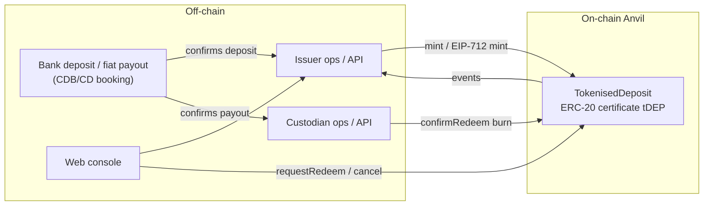
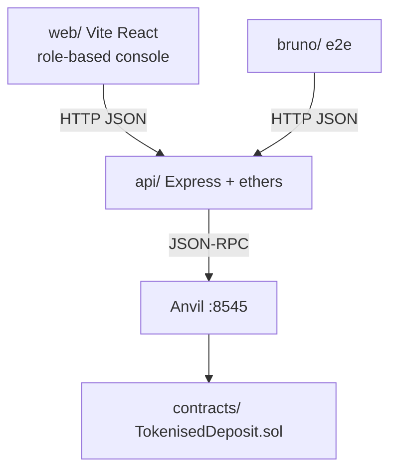
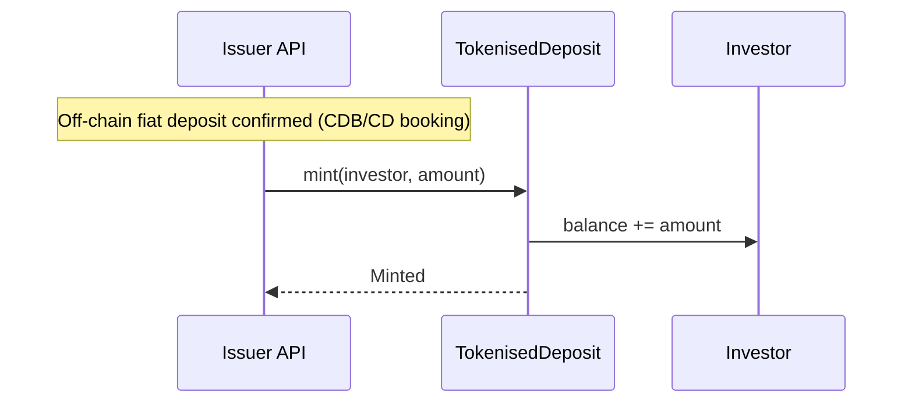
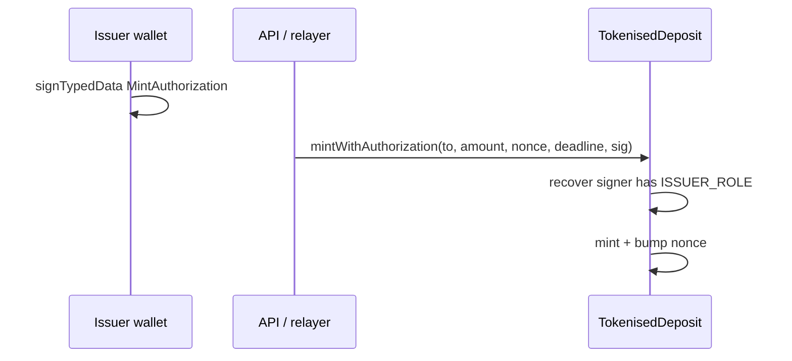
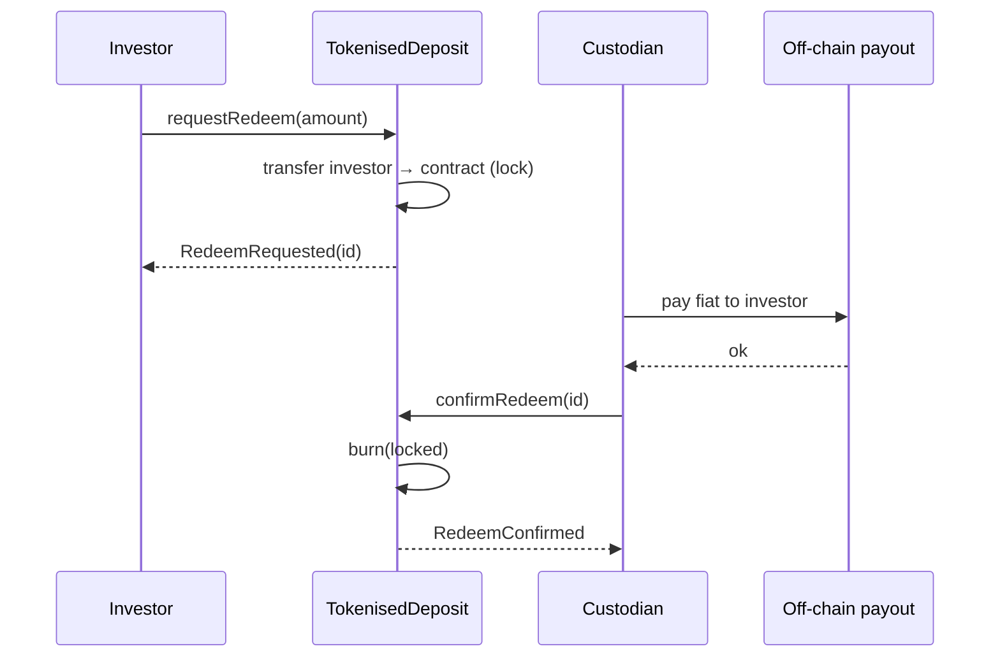
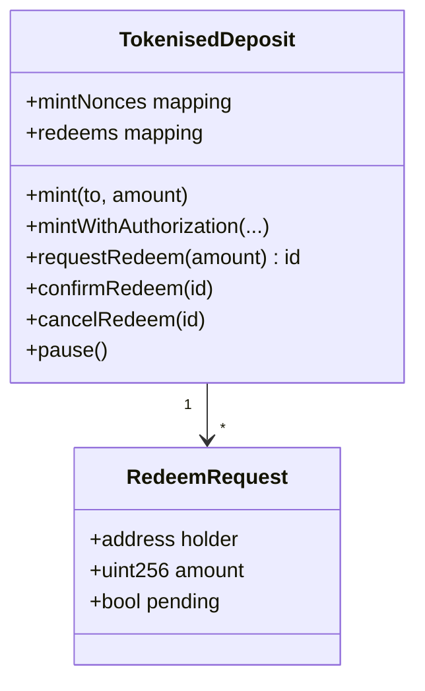

# Architecture - Tokenised Deposit

## 0. PoC (market language)

| Reference | Instrument |
| --- | --- |
| Brazil | CDB (Certificado de Depósito Bancário), tokenised form |
| US / general | Certificate of Deposit (CD); bank deposit token |
| What it is **not** | Credit/loan certificate; generic reserve-backed stablecoin; DeFi vault with on-chain collateral |

The contract issues the **on-chain deposit certificate**. Cash remains in custody.

See also: [`poc.md`](./poc.md).

## 1. Overview (on-chain / off-chain)



## 2. Component diagram



## 2.1 Web console (role-based)

The UI uses a **mock sign-in**: the user picks Investor, Issuer desk, or Custodian desk. Session state is client-side only (no real auth server).

| Role | Screens / actions |
| --- | --- |
| Investor | View position; request redeem; cancel pending redeem |
| Issuer | Issue certificate (`mint`); optional advanced EIP-712 signed mint via relayer |
| Custodian | Confirm redeem (burn after off-chain payout) |

EIP-712 signed mint is behind an Advanced control on the issuer desk: issuer signs off-chain; relayer submits `mintWithAuthorization`. Direct `mint` remains the default issuance path.

## 3. Use cases (simplified UML)

```mermaid
usecaseDiagram
  actor Investor
  actor Issuer
  actor Custodian
  actor Admin

  Investor --> (Sign in as investor)
  Investor --> (Request redeem)
  Investor --> (Cancel redeem)
  Issuer --> (Sign in as issuer)
  Issuer --> (Mint certificate)
  Issuer --> (Sign EIP-712 mint auth)
  Custodian --> (Sign in as custodian)
  Custodian --> (Confirm redeem)
  Admin --> (Pause / unpause)
```

## 4. Sequence - direct issuance



## 5. Sequence - EIP-712 issuance



## 6. Sequence - two-step redeem



## 7. On-chain data model



## 8. Design decisions (summary)

| Choice | Why (keep it simple) |
| --- | --- |
| ERC-20 certificate without on-chain collateral | Matches tokenised deposit / CDB-CD model: cash off-chain |
| AccessControl roles | Issuer vs custodian separation (four-eyes) |
| Two-step redeem | Mirrors operational settlement; avoids burn before payout |
| Lock in the contract itself | Clear accounting; cancel returns tokens |
| EIP-712 mint auth | Off-chain authorisation without account abstraction |
| Pausable | Minimal operational kill-switch |
| In-memory event mirror in the API | Enough for Anvil demo; avoids Postgres in v1 |
| Anvil accounts 0-3 | Deterministic, documented, easy to test |

## 9. Conscious threats (demo)

- Issuer/custodian keys in the API (acceptable **only** on local Anvil)
- No production timelock / multisig
- No on-chain proof of the off-chain deposit (trust the issuer; intentional in this RWA-lite model)
